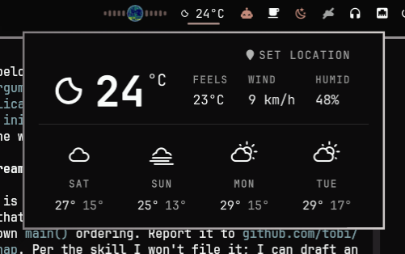

# Weather — Open-Meteo conditions for the Omarchy bar

A compact condition icon and temperature in the bar, with a details panel:
current conditions, a click-to-edit location picker, and a multi-day forecast.
Data comes from [Open-Meteo](https://open-meteo.com/) (no API key), and the
location is the same one Omarchy's own weather widget stores, so both stay in
sync.



## What it does

- **In the bar:** a weather icon and the current temperature. Left click opens
  the panel, right or middle click refreshes immediately.
- **The panel:** current conditions with feels-like, wind and humidity, plus a
  forecast strip for the next few days (high / low and condition icon).
- **Location picker:** click the location to edit it. Type a name and pick from
  geocoded suggestions, or enter coordinates. Saves through
  `omarchy-weather-location`, so it is shared with Omarchy's own weather panel.
- **Units:** metric by default; set `unit` to `imperial` for °F and mph.

## Controls

| Where | Action |
|---|---|
| Bar | left click = open/close the panel · right or middle click = refresh |
| Panel | click the location to edit it · pick a geocoded suggestion or type coordinates |

## Install

```sh
omarchy plugin add https://github.com/joseluiss2003/joseluis.weather.git --enable --yes
```

Requires Omarchy 4 (Quattro), `curl`, and the bundled `omarchy-weather-location`
helper. No other packages. Network access to `api.open-meteo.com` and
`geocoding-api.open-meteo.com` is used for the forecast and location search.

To place it in a specific bar section:

```sh
omarchy plugin enable joseluis.weather right
```

## Configuration

| Setting | Default | Notes |
|---|---|---|
| `unit` | `metric` | `metric` (°C, km/h) or `imperial` (°F, mph) |
| `refreshMinutes` | `15` | How often the forecast is re-fetched |

The chosen location lives in `~/.local/state/omarchy/settings/weather.json`
(format owned by `omarchy-weather-location`).

## Remove

```sh
omarchy plugin remove joseluis.weather --yes
```

## IPC

```sh
omarchy-shell joseluis.weather open
omarchy-shell joseluis.weather close
omarchy-shell joseluis.weather toggle
```

## How it works

- `Weather.qml` is the bar widget: it renders the icon and temperature and
  forwards clicks.
- `Panel.qml` is the details popup and owns the polling — one `curl` for the
  Open-Meteo forecast, plus one for geocoding while editing the location.
- `Model.js` holds the pure helpers (parsing the location file, mapping
  Open-Meteo weather codes to the same icon glyphs Omarchy uses, unit
  conversion, forecast slicing).

## License

MIT
